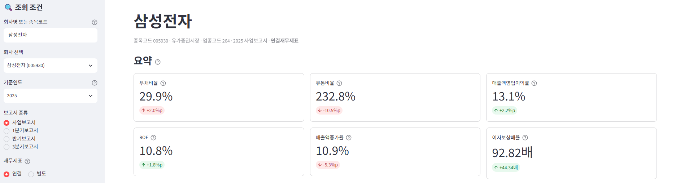
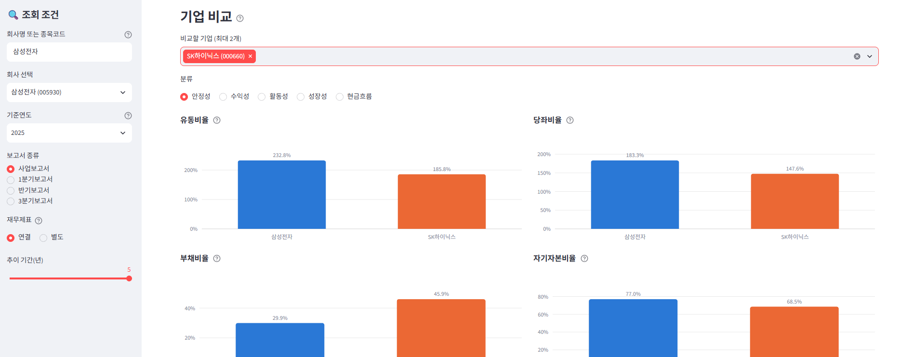

# 📊 DART 재무비율 대시보드

회사명을 검색하면 **금융감독원 [OpenDART](https://opendart.fss.or.kr) API**에서 재무제표를 가져와
16개 재무비율(안정성·수익성·활동성·성장성·현금흐름)을 계산하고,
**최근 5개년 추이**와 **최대 3개 기업 비교**를 시각화하는 Streamlit 웹앱입니다.

> 회계 지식(공인회계사 1차 합격)을 바탕으로 **"비율을 어떻게 계산해야 맞는가"**에 집중했습니다.
> 계산 결과는 금융감독원이 제공하는 재무지표와 대조해 검증했습니다. → [검증 문서](docs/verification.md)

- 🔗 **배포 주소: https://dart-ratio-dashboard.streamlit.app/**
- 📒 개발 과정: [docs/devlog.md](docs/devlog.md) · 🤖 AI 프롬프트 기록: [docs/prompts.md](docs/prompts.md)

---

## 주요 기능

| 기능 | 설명 |
|---|---|
| 🔍 회사 검색 | 상장사 회사명·종목코드 검색. 띄어쓰기·대소문자를 무시하고, 정확히 일치하는 회사를 맨 위에 보여줌 |
| 📑 보고서 선택 | 사업보고서 / 1분기 / 반기 / 3분기, 연결 / 별도. **연결이 없으면 별도로 자동 대체하고 화면에 표시** |
| 🧮 비율 계산 | 16개 비율. 평균 잔액 사용, 연결 ROE는 지배기업 소유주 기준, 분기는 연환산 |
| 💳 요약 카드 | 핵심 비율 6개 + 전년 대비 증감(%p), ⓘ에 공식 툴팁 |
| 📈 추이 차트 | 분류별 탭에서 최근 3~5개년 추이 차트와 표 |
| 🆚 기업 비교 | 최대 3개 기업의 같은 비율을 막대·추이·표로 비교 |
| 🧾 원본 데이터 | 계산에 쓴 계정·금액·매칭 방법을 표로 보여주고 CSV 다운로드 |
| ⚠️ 경고 | 금융업, 상장폐지, 자본잠식·분모 0 등 계산 불가 사유 표시 |

## 스크린샷

| 요약 카드 | 기업 비교 |
|---|---|
|  |  |

---

## 재무비율 공식

공식은 [`src/calculations.py`](src/calculations.py)의 각 함수 docstring 첫 줄에 있고, **화면 툴팁도 그 문장을 그대로 읽어 씁니다.** 그래서 코드와 화면의 공식이 어긋날 수 없습니다.

| 분류 | 비율 | 공식 | 단위 |
|---|---|---|---|
| 안정성 | 유동비율 | 유동자산 ÷ 유동부채 × 100 | % |
| 안정성 | 당좌비율 | (유동자산 − 재고자산) ÷ 유동부채 × 100 | % |
| 안정성 | 부채비율 | 부채총계 ÷ 자본총계 × 100 | % |
| 안정성 | 자기자본비율 | 자본총계 ÷ 자산총계 × 100 | % |
| 안정성 | 이자보상배율 | 영업이익 ÷ 이자비용 | 배 |
| 수익성 | 매출액영업이익률 | 영업이익 ÷ 매출액 × 100 | % |
| 수익성 | 매출액순이익률 | 당기순이익 ÷ 매출액 × 100 | % |
| 수익성 | ROE | 당기순이익 ÷ 평균 자기자본 × 100 | % |
| 수익성 | ROA | 당기순이익 ÷ 평균 총자산 × 100 | % |
| 활동성 | 총자산회전율 | 매출액 ÷ 평균 총자산 | 회 |
| 활동성 | 매출채권회전율 | 매출액 ÷ 평균 매출채권 | 회 |
| 활동성 | 재고자산회전율 | 매출액 ÷ 평균 재고자산 | 회 |
| 성장성 | 매출액증가율 | (당기 매출액 − 전기 매출액) ÷ 전기 매출액 × 100 | % |
| 성장성 | 영업이익증가율 | (당기 영업이익 − 전기 영업이익) ÷ 전기 영업이익 × 100 | % |
| 성장성 | 총자산증가율 | (기말 총자산 − 기초 총자산) ÷ 기초 총자산 × 100 | % |
| 현금흐름 | 영업현금흐름/순이익 | 영업활동현금흐름 ÷ 당기순이익 | 배 |

### 계산 기준

- **평균 잔액** = (기초 + 기말) ÷ 2. 기초 잔액은 같은 보고서의 전기말 금액(`frmtrm_amount`)을 씁니다.
- **연결 ROE** = 지배기업 소유주 귀속 순이익 ÷ 평균 지배기업 소유주지분. 별도 기준은 당기순이익 ÷ 평균 자본총계입니다.
- **분기·반기 연환산**
  - ROE·ROA·회전율의 손익은 누적 금액 × 12 ÷ 누적 개월 수로 환산합니다. 예: 3분기는 × 12/9.
  - 이익률·성장률은 같은 기간끼리 나누므로 연환산하지 않습니다.
- **분기 손익은 누적값 사용**: OpenDART 분기 손익의 `thstrm_amount`는 3개월치이고, 누적은 `thstrm_add_amount`입니다.
- **계산할 수 없는 경우**: 분모가 0이거나 음수(자본잠식 등)면 값 대신 사유를 표시합니다.
- **성장률의 적자 처리**: 전기가 적자이면 증가율 대신 "흑자전환" 또는 "적자지속"으로 표시합니다.
- **이자비용 대용치**: 손익계산서에 이자비용이 없으면 현금흐름표의 '이자의 지급'(현금기준)을 쓰고 표시합니다. 삼성전자 등 대형사 대부분이 '금융비용'으로만 공시합니다.
- **재고자산회전율은 매출액 기준**: 성격별 손익계산서를 쓰는 회사는 매출원가가 없어서, 한국은행 기업경영분석과 같은 기준으로 통일했습니다.

---

## 검증 결과

앱의 계산을 **OpenDART의 다른 API**와 대조했습니다. 자세한 내용은 [docs/verification.md](docs/verification.md)에 있습니다.

| 대조 대상 | 비교 기준 | 결과 |
|---|---|---|
| 계정 금액 | 주요계정 API | 3개사 사업보고서·2개사 반기보고서, **대조 항목 전부 일치** |
| 재무비율 | 금융감독원 주요 재무지표 API | **ROE·분기 회전율 외 전부 일치** |

차이 난 비율은 둘 다 앱이 의도한 기준 차이이며, 재현 계산으로 원인을 확정했습니다.
- ROE: 앱은 지배기업 귀속 기준, DART는 비지배지분을 포함한 전체 기준
- 분기 회전율: 앱은 연환산, DART는 연환산하지 않음

---

## 실행 방법

### 1) 준비
- Python 3.12 이상 (개발 환경: 3.15, numpy 2.5가 3.12 이상 필요)
- OpenDART 인증키: [opendart.fss.or.kr](https://opendart.fss.or.kr) → 인증키 신청 (무료)

### 2) 설치

```bash
git clone https://github.com/tjdal4418-sketch/dart-ratio-dashboard.git
cd dart-ratio-dashboard
python -m venv .venv
.venv\Scripts\activate          # macOS/Linux: source .venv/bin/activate
pip install -r requirements.txt
```

### 3) API 키 설정
`.env.example`을 복사해 `.env`를 만들고 인증키를 넣습니다. `.env`는 git에 올라가지 않습니다.

```
DART_API_KEY=발급받은_40자리_인증키
```

### 4) 실행

```bash
streamlit run app.py          # 웹앱
pytest                        # 단위 테스트 (80개, API 호출 없음)
python -m scripts.verify_reports       # DART 지표와 대조 검증
python -m scripts.check_matching --random 20   # 무작위 상장사 계정 매칭 점검
```

### Streamlit Community Cloud 배포
1. [share.streamlit.io](https://share.streamlit.io)에서 이 저장소와 `app.py`를 선택합니다.
2. **Advanced settings**
   - Python 버전: 3.13
   - Secrets에 아래 한 줄 입력

   ```toml
   DART_API_KEY = "발급받은_인증키"
   ```

   Streamlit은 최상위 Secrets 값을 환경변수로도 넣어주기 때문에, 코드 수정 없이 `os.getenv`로 읽힙니다.

---

## 프로젝트 구조

```
├── app.py                  # Streamlit 화면 (계산 로직 없음, src/ 함수 호출만)
├── src/
│   ├── dart_client.py      # API 호출, status 코드별 예외, 에러 메시지 속 API 키 노출 방지
│   ├── corp_code.py        # 기업 고유번호 다운로드·캐시(7일), 상장사 필터, 검색
│   ├── financials.py       # 재무제표·기업개황 수집, 연결→별도 대체, 파일 캐시
│   ├── account_map.py      # ⚙️ 계정 매칭 규칙 (표준계정코드 우선 → 계정명) — 설정 파일
│   ├── parser.py           # 금액 변환, 계정 매칭, 보고서별 당기/비교 필드 선택
│   ├── calculations.py     # 🧮 재무비율 순수 함수 (공식 = docstring 첫 줄)
│   ├── ratios.py           # 계정표 → 비율표 조립 (연환산·연결 ROE·대용치 규칙)
│   └── industry.py         # 금융업 판별
├── tests/                  # pytest 80개 (샘플 데이터 사용, API 호출 없음)
├── scripts/
│   ├── verify_reports.py   # DART 주요계정·재무지표 API와 대조 검증
│   └── check_matching.py   # 여러 회사 계정 매칭 점검
└── docs/                   # 개발 일지, 프롬프트 기록, 검증 문서
```

**데이터 흐름**: `dart_client`(호출) → `financials`(수집·캐시) → `parser` + `account_map`(계정표) → `ratios` + `calculations`(비율표) → `app`(화면)

## 기술 스택

| 구분 | 사용 기술 |
|---|---|
| 언어 | Python 3.15 |
| 웹 화면 | Streamlit |
| 데이터 처리 | pandas |
| 시각화 | Plotly (색각이상 검증을 통과한 팔레트 사용) |
| API 호출 | requests, python-dotenv |
| 테스트 | pytest, Streamlit AppTest |
| 데이터 | 금융감독원 OpenDART API |

---

## 한계점과 향후 계획

### 한계점
- **이자보상배율은 대용치일 수 있음**: 이자비용은 주석에만 있는 경우가 많은데, OpenDART 재무제표 API는 주석을 제공하지 않습니다.
- **금융업은 분석 대상이 아님**: 은행·보험·증권은 경고만 띄우고, 업종 전용 지표(BIS 비율, NIM 등)는 계산하지 않습니다.
- **일부 연도 데이터 없음**: OpenDART가 데이터를 주지 않는 연도는 제외합니다. 예: KB금융 2021~2022년.
- **약칭 검색 불가**: 정식 법인명으로만 찾을 수 있습니다. 예: '현대차'로는 '현대자동차'가 검색되지 않습니다.
- **상장폐지 기업이 검색됨**: 기업 목록 파일에 옛 종목코드가 남아 있어 검색 결과에 나옵니다. 선택하면 경고를 띄웁니다.
- **캐시 기간**: 한 번 받은 보고서는 다시 받지 않으므로, 정정공시를 반영하려면 `.cache/fs/`를 지워야 합니다.

### 향후 계획
- [ ] 같은 업종 기업 자동 추천 (업종코드 기반)
- [ ] 금융업 전용 지표
- [ ] 회사 약칭 사전
- [ ] 듀퐁 분석(ROE = 순이익률 × 총자산회전율 × 재무레버리지)
- [ ] 분기별(직전 분기 대비) 추이

---

## AI(Claude Code) 활용 방식

이 프로젝트는 **Claude Code**(Anthropic의 AI 코딩 도구)와 함께 만들었습니다. 저는 회계 지식은 있지만 개발은 처음이라, 다음 원칙으로 AI를 활용했습니다.

1. **설계 먼저, 코딩은 승인 후에**: 바로 코드를 짜게 하지 않고, 폴더 구조·단계별 계획·확인할 질문을 먼저 받아 검토한 뒤 한 단계씩 진행했습니다.
2. **회계 판단은 제가 내림**: AI가 판단이 필요한 지점을 질문하면 제가 결정했습니다.
   - 분기 비율 연환산 여부
   - 분기 기초 잔액 기준
   - 이자비용 대용치 사용 여부
3. **실제 데이터로 확인**: 추측으로 코드를 쓰지 않고, 실제 API 응답을 먼저 열어 본 뒤 설계했습니다. 분기 손익의 3개월/누적 필드 구조나, 대형사 대부분이 이자비용을 따로 공시하지 않는다는 사실도 이 과정에서 발견했습니다.
4. **설명할 수 있는 코드**: 면접에서 직접 설명할 수 있도록 단순한 구조와 한국어 주석을 요청했습니다.
5. **기록**
   - 모든 프롬프트: [docs/prompts.md](docs/prompts.md)
   - 단계별 결정과 문제 해결 과정: [docs/devlog.md](docs/devlog.md)

---

데이터 출처: 금융감독원 전자공시시스템 OpenDART. 이 앱은 학습·포트폴리오용이며 투자 권유가 아닙니다.
